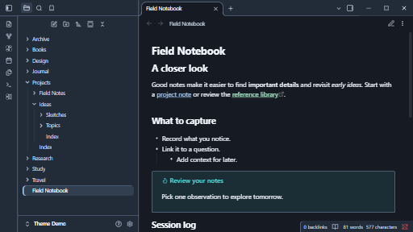

# Clear Contrast Accessible

An Obsidian theme that keeps secondary text, navigation and controls clearly readable.

Source version 3.8.2. The theme supports dark and light modes and requires Obsidian 1.15.1 or later.

The theme emphasises readable secondary text, visible keyboard focus and underlined links.

## Preview

## Install manually

1. Download `manifest.json` and `theme.css` from [the latest published release](https://github.com/tutivsoft-com/obsidian-theme-clear-contrast-accessible/releases/latest).
2. Put both files in `.obsidian/themes/Clear Contrast Accessible/` in your vault.
3. Open **Settings > Appearance** and select **Clear Contrast Accessible**. Choose a supported base colour scheme.

## Verify the source

Install the test dependency with `python -m pip install "tinycss2>=1.4,<2"` and run `python -B -m unittest discover -s tests`. The tests parse the stylesheet, check version metadata and link underlining, and measure representative text and focus contrast in both palettes against the [WCAG 2.2 thresholds](https://www.w3.org/TR/WCAG22/).

See the [Obsidian UI verification and screenshots](docs/ui-test/2026-11-24/README.md).

See the [original design plan](PLAN.md). [MIT license](LICENSE).
