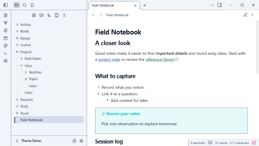

# Clear Contrast Accessible

An Obsidian theme that keeps secondary text, navigation and controls clearly readable.

Source version 3.8.0. Modes supported: Dark and light. Tested in Obsidian 1.15.1 on Windows.

The theme emphasises readable secondary text, visible focus and underlined links.

## Preview

## Install manually

1. Download `manifest.json` and `theme.css` from [release 1.0.0](https://github.com/tutivsoft-com/obsidian-theme-clear-contrast-accessible/releases/tag/1.0.0).
2. Put both files in `.obsidian/themes/Clear Contrast Accessible/` in your vault.
3. Open **Settings > Appearance** and select **Clear Contrast Accessible**. Choose a supported base colour scheme.

See the [original design plan](PLAN.md). [MIT license](LICENSE).
